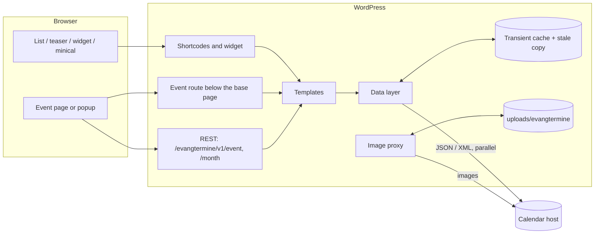
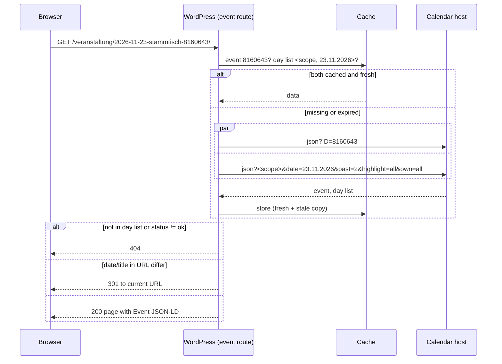

# Spec 4.0.0: every event becomes a page of the WordPress site

| | |
|---|---|
| Status | Accepted (design), not implemented; revised after the review on PR #127 |
| Epic | [#107](https://github.com/habakuk007/evangtermine/issues/107), milestone 4.0.0, sub-issues #108–#126 |
| Created | 2026-11-22 (grill-me design session) |
| Owner | habakuk007 |

This document is the single source of truth for the **design** of 4.0.0. The GitHub issues track the **work** (tasks, acceptance criteria) and link to the sections here. A change to a decision is made by a PR against this file and recorded in the [decision log](#16-decision-log).

## Contents

1. [Goal and non-goals](#1-goal-and-non-goals)
2. [Remote interface facts](#2-remote-interface-facts)
3. [Architecture overview](#3-architecture-overview)
4. [Data layer and caching](#4-data-layer-and-caching)
5. [Event URLs and routing](#5-event-urls-and-routing)
6. [Scope check](#6-scope-check)
7. [Event lifecycle and status codes](#7-event-lifecycle-and-status-codes)
8. [Event detail content](#8-event-detail-content)
9. [SEO: canonical, structured data, SEO plugins, sitemap](#9-seo-canonical-structured-data-seo-plugins-sitemap)
10. [Lists, filters and paging](#10-lists-filters-and-paging)
11. [Popup and mobile](#11-popup-and-mobile)
12. [Minical, panels and widget](#12-minical-panels-and-widget)
13. [Images and privacy](#13-images-and-privacy)
14. [Upgrade, compatibility mode, requirements](#14-upgrade-compatibility-mode-requirements)
15. [Open questions](#15-open-questions)
16. [Decision log](#16-decision-log)

---

## 1. Goal and non-goals

### Goal

Today every event in a list links to the remote calendar, e.g. `https://www.evangelische-termine.de/veranstaltung_im_detail8160643.html?PHPSESSID=&popup=1&css=none`. In 4.0.0 every event that belongs to the site gets **its own page on the WordPress site**, so that for search engines the event is part of the site:

- a meaningful URL with date and title,
- still opened as a popup from the lists (on wide screens), but with a real URL that works with "open in new tab", without JavaScript and for crawlers,
- structured data for Google ([Event](https://developers.google.com/search/docs/appearance/structured-data/event)),
- all features of the remote detail page,
- a clear canonical strategy.

### Non-goals

| Not in 4.0.0 | Why / when |
|---|---|
| Importing events into a custom post type | Decided against: live fetching with caching keeps the plugin small and always current. |
| SOAP API | Needs a per-organiser API key, has no read method for events; the handbook itself recommends XML/JSON for reading. |
| Gutenberg blocks | 4.1, built on the same templates. |
| Theme template overrides (`yourtheme/evangtermine/*.php`) | Later, once the templates are stable. 4.0 offers CSS and filter hooks. |
| AMP | Ignored (no support, no tests). |
| Embedded maps, Google Maps link | 4.1: OpenStreetMap map on the event page ([#128](https://github.com/habakuk007/evangtermine/issues/128)), optional Google Maps link marked as external ([#129](https://github.com/habakuk007/evangtermine/issues/129)). 4.0 shows an OpenStreetMap link only. |

---

## 2. Remote interface facts

Verified on 2026-11-22 against the documentation ([Anzeige im Internet](https://handbuch.evangelische-termine.de/anzeige-im-internet), [Ausgabe-Parameter](https://handbuch.evangelische-termine.de/anzeige-im-internet/ausgabe-parameter), [Weitere XML/JSON-Daten](https://handbuch.evangelische-termine.de/weitere-xml-json-daten)) and by live requests.

### Endpoints

| Endpoint | Returns | Used for |
|---|---|---|
| `/json?<params>` | JSON array of `{"Veranstaltung": {…}}`, no total count | lists, scope check, sitemap |
| `/json?ID=<ID>` | `{"detail": {label: html, …}, "0": {"Veranstaltung": {…}}}` | single event |
| `/xml?<params>` | XML with `<meta><totalItems>`, `activeParams`, lookup lists, `<months>` | total count for paging, month filter |
| `/service/eventtypes.json`, `/service/people.json`, `/service/channels-<vid>.json`, `/service/subregions.json`, `/service/regions.json`, `/userofdekanat?subregion=NNN` | lookup lists | filter options, settings |
| `/ical-<ID>` | iCal file of one event | "add to calendar" |
| `/veranstaltung_im_detail<ID>.html`, `/d-<ID>` | remote detail page | link target for out-of-scope events |

### Facts that shape the design

- **List items carry the same 132 `Veranstaltung` fields as `json?ID=`, but not the `detail` block.** A list request fills the cache for list rendering, slugs, the sitemap and JSON-LD; the event page and the popup need `json?ID=` (cached) for the input-mask-specific `detail` block.
- **Page size:** without `itemsPerPage` a JSON list returns up to 3,000 items; with `itemsPerPage=N` at most N. Every request sends an explicit `itemsPerPage`.
- **`json?ID=` ignores `vid`.** `json?vid=3&ID=8160643` returns an event of another organiser. Any event of the whole calendar can be requested, so a [scope check](#6-scope-check) is mandatory.
- **`ID` is the date occurrence** (e.g. `8160643`); `_event_ID` is the event or series (e.g. `2567671`). URLs use `ID`.
- **Unknown ID:** HTTP 200 with the plain text `Diese Veranstaltung existiert nicht.`
- **`_event_STATUS`:** `ok`, or `standby` for locked ("gesperrt") events. Locked events are missing from all lists but are still returned by `json?ID=` and shown on the remote detail page. A value for cancelled events was not found (see [open questions](#15-open-questions)).
- **Highlights:** `_event_HIGHLIGHT` is `low`, `high` (Veranstalter-Highlight) or `rhigh` (regionales Highlight). **A `region=` query without `highlight=all` returns only highlights** (region 201: 74 instead of 4,280 events). Always send `highlight=all` unless highlights are filtered on purpose. `highlight=high` did not return `rhigh` items, so combine both client-side.
- **Dates:** `START` is local time in Europe/Berlin; `START_RFC` / `END_RFC` carry the offset. Raw `END` can be `0000-00-00 21:30:00`. `MODE` is `vonbis` or `jeweils`; `allDay` is `1` or empty. Multi-day and `jeweils` events appear in the day list of their start date and of the following days (verified).
- **Caching headers:** `cache-control: max-age=0, must-revalidate, private`, no `ETag`, no `Last-Modified`. Only TTL caching is possible. `_event_MODIFIED` (`dd.mm.yyyy hh:mm`) is the change date.
- **Timings** (dev PC): single event 0.15–0.75 s; 20 single events 9.0 s sequential, 3.8 s with 10 in parallel; `xml?…&itemsPerPage=1` ~4 KB, 0.15–0.5 s.
- **The remote detail page** declares itself canonical (`/d-<ID>`), has its own Event JSON-LD and og tags, links Google Maps, iCal and print.

### Calendar hosts

All seven hosts of the software ([#62](https://github.com/habakuk007/evangtermine/issues/62)) behave identically for everything above:

| Host | Image host |
|---|---|
| `www.evangelische-termine.de` (default) | `et-live.obsv3.de-global-1.spacenet.cloud` |
| `termine.ekir.de`, `www.ekbo-termine.de`, `termine.ekhn.de`, `kalender.evlks.de`, `www.veranstaltungen-ekvw.de`, `termine.kirche-oldenburg.de` | the calendar host itself |

---

## 3. Architecture overview

The plugin stays a **live-fetching** plugin. The data source changes from remote HTML to the JSON interface, and the plugin renders all output with its own templates.



The browser only talks to the WordPress site in the new mode.

### Request flow of an event page



---

## 4. Data layer and caching

Issues: [#108](https://github.com/habakuk007/evangtermine/issues/108), [#109](https://github.com/habakuk007/evangtermine/issues/109).

### Requests

- HTTP via the WordPress HTTP API with `reject_unsafe_urls` and the existing `Evangtermine_Query::isSafeHost()` check.
- Parallel requests via `WpOrg\Requests\Requests::request_multiple()` on WordPress 6.2+ and `Requests::request_multiple()` (Requests 1.x) on 5.8–6.1; sequential requests are the last fallback.
- Parallel pairs: list + XML count; single event + day-list scope check.
- Timeouts: 5 s for lists, 3 s for single events and the day check.

### Cache

| What | Key | Fresh TTL (default) | Stale copy |
|---|---|---|---|
| List (shortcode, teaser, widget, panels) | hash of the normalised parameters | 15 min (setting) | 7 days |
| List with visitor input (filters, search) | same | 5 min | 7 days |
| Single event | `ID` | 60 min (setting) | 7 days |
| Day list for the scope check | scope + date | 60 min | 7 days |
| Lookup lists | endpoint | 24 h | 30 days |

- Storage: transients (a persistent object cache is used automatically when present). The stale copy is a second transient; there is **no** extra database copy. A full object-cache flush while the remote host is down is accepted as a rare case (the list shows "Termine derzeit nicht verfügbar", event pages answer 503).
- List items also fill the single-event cache with the `Veranstaltung` fields; the `detail` block comes from `json?ID=` and is cached with the same TTL.
- **TTL jitter:** every TTL gets a random ±10 % so entries written together do not expire together.
- **Negative cache:** "does not exist" and "out of scope" results are cached for 10 minutes, so repeated requests for wrong IDs cause no remote calls.
- **Cold-miss limit:** remote fetches triggered by an event URL or the REST endpoint for an ID that is not in the cache are limited per client IP (e.g. 30 per minute, counter in a transient). Above the limit the plugin answers 429 without contacting the remote host. This stops enumeration of IDs from turning the site into an amplifier against the calendar host.
- Refresh: the first request after expiry refreshes inline and holds a short lock; parallel requests get the stale copy. On error or timeout the stale copy is served.

### "Cache leeren" and page caches

There are two independent layers:

| Layer | Stores | Emptied by |
|---|---|---|
| Full-page cache (WP Rocket, LiteSpeed Cache, WP Super Cache, W3 Total Cache, host caches) | finished HTML | the caching plugin (button, lifetime, post save) |
| Plugin cache | raw remote data | plugin TTL, plugin button |

- Clearing the page cache does **not** clear plugin data: pages are rebuilt from data that can be up to one TTL old. Some caching plugins also flush the object cache; then the plugin data is gone too and is fetched again.
- The plugin's "Cache leeren" button clears the plugin data **and** calls the purge function of detected page-cache plugins (`rocket_clean_domain()`, `do_action( 'litespeed_purge_all' )`, `wp_cache_clear_cache()`, `w3tc_flush_all()`, …), then fires `do_action( 'evangtermine_cache_cleared' )`.
- When a page-cache plugin is detected, the settings page explains: effective worst-case age = plugin TTL + page-cache lifetime.
- The REST endpoints send `Cache-Control: max-age=<TTL>`.
- **Known gap: page caches and status codes.** A page cache keeps serving a cached 200 of an event page after the event was moved (301), deleted (410) or locked (404), until the cached HTML expires. Mitigations: where a page-cache plugin offers a per-page lifetime (e.g. LiteSpeed via `litespeed_control_set_ttl`), event pages get the plugin TTL as page lifetime; otherwise the gap is documented and "Cache leeren" purges it. The behaviour of each supported page-cache plugin is checked in #124.

### Diagnostics

A non-autoload option holds a cache index (key, stored, expires, size, type). It is written only when a remote fetch stores new data (never on cache hits), at most once per request. Hit and miss counters are collected in a transient and added to the index at most every 5 minutes. The settings page shows:

- entries per type and total size; oldest and newest entry,
- hits and misses since the last reset,
- persistent object cache yes/no (`wp_using_ext_object_cache()`),
- "Cache wurde extern geleert am …" (a marker transient is gone while the index still lists entries),
- last clear via the button,
- last remote error (time, HTTP code or timeout) and last successful fetch.

---

## 5. Event URLs and routing

Issue: [#110](https://github.com/habakuk007/evangtermine/issues/110).

### Base page

- On activation and on upgrade the plugin creates a normal WordPress page "Veranstaltung" containing the placeholder `[et_detail]` and stores its ID in a setting (selectable in the settings).
- **Collision rule:** if a published page already contains `[et_detail]`, it is adopted. Otherwise a new page is created; if the slug `veranstaltung` is taken, WordPress' unique slug (e.g. `veranstaltung-2`) is used and the admin notice names the resulting URL.
- Editors can rename, move and edit it like any page. Text around the placeholder appears on every event page.
- When an event is requested, the plugin replaces the page title, document title, meta description, canonical and og tags and fills the placeholder.
- Admin notice when the page is missing, trashed or unpublished.
- Breadcrumb parent = the parent page of the base page.

### URL format

```
/<base-page-path>/YYYY-MM-DD-<title-slug>-<ID>/
/veranstaltung/2026-11-23-stammtisch-der-glaubenden-und-zweifelnden-8160643/
```

- `<title-slug>`: `sanitize_title()` of `_event_TITLE`, at most ~60 characters.
- The date is the start date from `START` (Europe/Berlin, as delivered by the calendar host), independent of the WordPress time zone setting. It makes recurring events (e.g. 52 Sunday services) distinguishable in search results and when shared.
- **The `ID` is authoritative.** If the date or title part differs from the current data, the response is a 301 to the current URL (renamed or moved events, made-up slugs).
- Rewrite rule below the base page path; rewrite rules are flushed on activation and when the base page's slug or parent changes.
- 3.x links with `?etID=<ID>` on list pages get a 301 to the event URL **in the new mode only**; in the compatibility mode `?etID=` keeps working as in 3.x.
- **Renaming or moving the base page** changes the prefix of every event URL. The plugin stores the previous base paths (option, last 5) and answers requests below an old path with a 301 to the same event below the current path, so indexed URLs move in one hop.

### Why a real base page and not a purely virtual route

A real page lets the theme render the event with its normal page template (classic and block themes), gives SEO plugins a real post to work with, and lets editors control text, layout and breadcrumb. This is the pattern WooCommerce and live-data plugins such as IDX real-estate plugins use.

---

## 6. Scope check

Issue: [#111](https://github.com/habakuk007/evangtermine/issues/111).

- Setting **"allowed organisers/regions"** (vid list, region list, kk), pre-filled from the global `vid` / `region` settings. Visitors can never change it.
- An event gets a page only if
  1. it appears in the day list `json?<scope>&date=<DD.MM.YYYY>&past=2&highlight=all&own=all&itemsPerPage=3000` (the date comes from the URL; this request runs in parallel with `json?ID=`), and
  2. `_event_STATUS === 'ok'`.
- **Fallback when the day list misses the event:** the date in the URL may be wrong (made-up link, moved event). The plugin then takes the real start date from `json?ID=` and, if it differs, repeats the day check for that date before deciding (followed by the 301 from section 5). Only if the event is missing from the day list of its real start date, the answer is 404.
- Size: for a single organiser or a Dekanat the day list is small (e.g. 56 events for region 201 on a Sunday); for very wide scopes (`region=all`) it can reach about 2,000 events. It is cached per scope and day and shared by all events of that day.
- The scope check is the first feature covered by the E2E tests (#124): in scope, out of scope, adopted, locked, multi-day, `jeweils`, wrong date in the URL.
- Adopted events of other organisers (`own=all`) pass, because they appear in the scope's list. Locked events (`standby`) fail.
- A shortcode or widget whose `vid` / `region` lies outside the scope links its events to the remote detail page, as in 3.x, and the settings page shows a warning naming the page.
- Visitors can no longer set `vid`, `region`, `kk`, `own` or `dest` via the URL (3.x accepts `?vid=` in `et_veranstalter`).

---

## 7. Event lifecycle and status codes

Issue: [#110](https://github.com/habakuk007/evangtermine/issues/110).

| Case | Detected by | Response |
|---|---|---|
| In scope, status `ok` | scope check | **200** |
| Past event | `END_RFC` / `START_RFC` before now | **200**, note "Diese Veranstaltung hat bereits stattgefunden" with a link to upcoming events. Stays indexed (never `noindex`), removed from the sitemap. |
| Moved or renamed | URL date/title differ from data | **301** to the current URL |
| Deleted at source | "Diese Veranstaltung existiert nicht." | **410** with the base page content and links to the calendar |
| Out of scope | not in the day list | **404** |
| Locked (`standby`) | status not `ok` | **404** (may come back when unlocked) |
| Cancelled | unknown representation | **200** with an "abgesagt" notice and `EventCancelled`, once known ([#126](https://github.com/habakuk007/evangtermine/issues/126)) |
| Remote down, stale copy exists | HTTP error / timeout | **200** from the stale copy |
| Remote down, no copy | HTTP error / timeout | **503** with `Retry-After` |

---

## 8. Event detail content

Issue: [#112](https://github.com/habakuk007/evangtermine/issues/112).

The event page and the popup show everything the remote detail page shows, from the JSON data:

- title, subtitle, date and time (`vonbis`, `jeweils`, all-day, multi-day),
- place: name, address, info text, place image with © caption, **OpenStreetMap link** from `_place_GLAT` / `_place_GLONG`,
- event image with copyright, licence and alt text (fallback: title), via the [image proxy](#13-images-and-privacy),
- short and long description (the long description is remote HTML: filtered with `wp_kses()` and a defined allowlist),
- input-mask specific fields from the `detail` block (labels differ per input mask),
- web link, contact person (name, email as `mailto:`), organiser,
- category, target group, channels, accessibility information, language,
- iCal generated locally from the JSON data (own route below the event URL or a REST route), so the visitor's browser never leaves the site,
- print (hidden on mobile),
- note for past events.

**Escaping rule:** every value from the JSON (texts, labels, links, image URLs, coordinates) is escaped for its context (`esc_html`, `esc_attr`, `esc_url`); HTML-bearing fields (long description, `detail` block) go through `wp_kses()` with a defined allowlist. Nothing from the remote host is printed unescaped.

**Accessibility:** the event page, the filter form and the lists follow the same WCAG 2.2 AA rules as the popup (headings, landmarks, labels, link texts, contrast, tap targets). Hiding print on mobile must not hide content.

Templates use `.et_` class names, close to the old remote markup where sensible. The filter hook `evangtermine_event_fields` lets developers add, remove or reorder fields.

---

## 9. SEO: canonical, structured data, SEO plugins, sitemap

Issues: [#113](https://github.com/habakuk007/evangtermine/issues/113), [#114](https://github.com/habakuk007/evangtermine/issues/114), [#115](https://github.com/habakuk007/evangtermine/issues/115), [#126](https://github.com/habakuk007/evangtermine/issues/126).

### Canonical

Every event is available at least twice: on the remote site (which declares itself canonical) and on the WordPress site, often also on regional portals. The plugin cannot change the remote page.

**Decision:** the event page is its **own canonical** (a canonical to the remote page would keep the page out of the index and defeat the goal). The plugin makes the page as distinct as it can: own Event JSON-LD with the parish as organiser, breadcrumb JSON-LD, its own meta description wording, sitemap entries, internal links from the lists, the base page's own text. There is no setting for a remote canonical.

**Residual risk:** search engines will still see near-duplicates (remote page, regional portals, the WordPress page) and may choose the remote page as canonical for many events. The design cannot remove this risk on its own. The clean fix is on the operator's side: a `noindex` or a canonical to the organiser's website on the remote page. This request ([#126](https://github.com/habakuk007/evangtermine/issues/126)) has **top priority** and should be sent before implementation starts.

**Success metric** (measured on 2–3 pilot sites with Google Search Console, 8 weeks after release): share of submitted event URLs that are indexed, impressions and clicks of event pages, and how often Search Console reports "Duplicate, Google chose different canonical than user". The results decide whether more measures are needed.

### Event JSON-LD

| schema.org | Source |
|---|---|
| `name` | `_event_TITLE` |
| `startDate` | `START_RFC` (date only if `allDay`) |
| `endDate` | `END_RFC`, only if there is a real end |
| `eventStatus` | `EventScheduled`; `EventCancelled` once the representation is known |
| `eventAttendanceMode` | from `ctype`: Präsenz → Offline, Online → Online, Hybrid / Blended → Mixed; default Offline |
| `location` | `Place` with `_place_NAME`, `PostalAddress` (street, ZIP, city, country `DE`), `GeoCoordinates`; online events: `VirtualLocation` with `_event_LINK` |
| `description` | `_event_SHORT_DESCRIPTION`, else the long description shortened to plain text |
| `image` | proxied image URL(s) on the own domain |
| `organizer` | `Organization` with `_user_REALNAME`, `_user_URL` |
| `url` | own event URL |
| `inLanguage` | from `_event_LANG` |

Not included: `offers` (there is no price data; the Search Console warning is accepted), `performer` (no data), and the **contact person** (personal data; it stays visible on the page).

Also: `BreadcrumbList` (home → parent page of the base page → event), `<title>`, meta description in own wording (date, place, organiser), og:title / description / url / image / type, Twitter card.

### SEO plugins

On event URLs WordPress renders the base page. Without integration, SEO plugins print the base page's title, description, og tags, JSON-LD and **canonical on every event**, which tells search engines that all events are duplicates of one page.

| Setup | Behaviour |
|---|---|
| No SEO plugin | Plugin outputs title, canonical, meta and og via core filters (`pre_get_document_title`, `get_canonical_url`, `wp_head`) and its own JSON-LD block. |
| All setups | Every filter returns its input unchanged unless the current request is an event URL. No output of other pages is touched. |
| Yoast SEO | Values replaced via `wpseo_title`, `wpseo_metadesc`, `wpseo_canonical`, `wpseo_opengraph_*`; Event added to their graph via `wpseo_schema_graph`; breadcrumb via `wpseo_breadcrumb_links`. |
| Rank Math | Equivalent `rank_math/frontend/*`, `rank_math/json_ld` and breadcrumb filters. |
| Any other SEO plugin (AIOSEO, SEOPress, The SEO Framework, …) | Admin warning, and all event pages get `noindex` via `wp_robots` until the plugin is supported. A wrong canonical on many pages is worse than no indexing. The warning is shown on the dashboard and the plugin's settings page until dismissed, names the detected plugin, lists the supported ones (core, Yoast SEO, Rank Math) and explains the consequence. |

### Sitemap

- All upcoming in-scope events within **365 days**, plus highlight events (`high`, `rhigh`) further in the future.
- `lastmod` from `_event_MODIFIED`. Past events are not listed.
- Core: own sitemap provider (`wp_register_sitemap_provider`). Yoast SEO and Rank Math: added to their sitemap index.
- **Data:** a dedicated request `json?<scope>&start=<today>&end=<today+365>&highlight=all&itemsPerPage=<cap>` plus one for highlights after the horizon. Wide scopes can mean several MB and more than 10 s, so the sitemap data is **built in the background** (a WP-Cron single event when the stored set is older than 6 hours) and stored in its own transient. A sitemap request always serves the last stored set and never waits for the remote host.
- Cap: 10,000 URLs; split at 2,000 URLs per file.

---

## 10. Lists, filters and paging

Issues: [#116](https://github.com/habakuk007/evangtermine/issues/116), [#117](https://github.com/habakuk007/evangtermine/issues/117).

### Rendering

`et_veranstalter`, `et_teaser` and the widget render from JSON with the plugin's own templates. Layout may change but stays similar to 3.x; `.et_` class names are kept close to the old markup so custom CSS partly keeps working. The `css` option (custom stylesheet URL) keeps working. In-scope events link to their event page, out-of-scope events to the remote detail page.

### Parameter groups

| Group | Parameters | Who sets them |
|---|---|---|
| Scope | `vid`, `region`, `kk`, `own`, `dest`, `auswahl` | shortcode / settings only |
| Pre-filters | `ipm`, `cha`, `tags`, `menue1` / `menue2`, `yesno1` / `yesno2`, `until`, `exp-start` / `exp-period`, `itemsPerPage` | shortcode only |
| Visitor filters | see below | visitor, if enabled in the shortcode |

### Visitor filters

Enabled per shortcode, e.g. `filters="month,q,eventtype,people,highlight"`; the order is fixed.

| Filter | Remote parameter | Options from | Default |
|---|---|---|---|
| Month | `d` / `month` | XML `meta/months` | on |
| Search | `q` | free text | on |
| Category | `eventtype` | `/service/eventtypes.json` | on |
| Target group | `people` | `/service/people.json` | on |
| Highlights only | `highlight` | checkbox (`high` + `rhigh`) | on |
| Place | `place` | derived from a larger cached scope list (only fetched when enabled) | off |
| Contact person | `person` | as place | off |
| Accessibility | `bf` | checkboxes | off |
| Language | `lang` | fixed list | off |
| ZIP | `zip` | text | off |
| Date range | `start` / `end` | date fields | off |
| Today | `today` | checkbox | off |
| Past events | `past` | checkbox | off |
| Continuing education | `prof`, `topic`, `ctype` | fixed lists | off |
| Channel | `cha` | `/service/channels-<vid>.json` | off |

### Rules

- Visitor parameters are prefixed `et_` (`et_month`, `et_q`, `et_type`, `et_page`, …), because `date`, `year`, `month` and `q` collide with WordPress query vars. Old 3.x names (`date`, `eventtype`, `people`, `et_q`, `pageID`, …) get a 301 to the new names.
- Plain GET form, works without JavaScript; the filter form does not reload results via AJAX in 4.0. (The popup in section 11 loads one event via REST; that is unrelated to the form.) On mobile the form collapses into a native `<details>` "Filter" toggle.
- One shared `et_` parameter set per page (no per-instance namespacing).
- Pages with an active filter or search: `noindex, follow`. Plain paging stays indexable.

### Paging

Numbered paging. `totalItems` comes from a parallel `xml?<same parameters>&itemsPerPage=1` request, which also delivers the month list for the month filter.

---

## 11. Popup and mobile

Issues: [#118](https://github.com/habakuk007/evangtermine/issues/118), [#122](https://github.com/habakuk007/evangtermine/issues/122).

- Every event link is a real `<a href>` to the event page.
- On wide screens a plain left click opens a native `<dialog>`: focus moves into the dialog, Esc closes it, focus returns to the link, the heading is announced.
- Content comes from `GET /wp-json/evangtermine/v1/event/<ID>`: the rendered detail fragment, with the same template, scope check, negative cache and cold-miss limit as the event page (section 4).
- `history.pushState` sets the event URL while the dialog is open; the back button closes it; a copied URL points to the event page.
- Inside the dialog: "Als eigene Seite öffnen", iCal, OpenStreetMap link, print.
- Used in `et_veranstalter`, `et_teaser`, the widget, `et_panels` and the minical.
- Setting **"Popup: auto (desktop only) / always / never"**, default **auto**: below a breakpoint (e.g. `min-width: 48em`) clicks are not intercepted and the event page opens normally.
- New mode: mobile-first stylesheet of the plugin; Bootstrap 3.3.7 and Font Awesome 4.7.0 only in the compatibility mode. Lists stack date, title and place on small screens; event pages use large tap targets; print is hidden on mobile.

---

## 12. Minical, panels and widget

Issues: [#119](https://github.com/habakuk007/evangtermine/issues/119), [#120](https://github.com/habakuk007/evangtermine/issues/120), [#116](https://github.com/habakuk007/evangtermine/issues/116).

| Output | 4.0 |
|---|---|
| Widget (`EtWidget`) | Rendered from JSON with the `et_teaser` template, popup and event links. Class name unchanged (stored in the database). |
| `et_minical` | The browser no longer contacts the calendar host: month data via `GET /wp-json/evangtermine/v1/month?…` (cached, scope-checked). Clicks open the shared popup. Colorbox removed; the jQuery UI datepicker stays for now. |
| `et_panels` | Rebuilt from JSON with an own template; no remote scripts in the new mode. |

---

## 13. Images and privacy

Issue: [#121](https://github.com/habakuk007/evangtermine/issues/121).

- **Image proxy with local cache:** the server downloads each image once into `wp-content/uploads/evangtermine/` and serves it from the own domain (also for og:image and the JSON-LD). No visitor IP goes to a third party.
- Allowed hosts: the configured `ethost` plus a built-in map of extra image hosts (`et-live.obsv3.de-global-1.spacenet.cloud` for the Bavarian host). Everything else is rejected. Downloads use `Evangtermine_Query::isSafeHost()` and `reject_unsafe_urls`, https only, no redirects to other hosts, so the proxy cannot be used for SSRF.
- Only JPEG, PNG and WebP, size cap ~5 MB, no SVG. A cron job deletes files unused for 30 days; uninstall removes the folder.
- Copyright and licence are always shown; alt text from the data, fallback title.
- Map: an OpenStreetMap link in 4.0 (no embedded map, no Google Maps). 4.1 adds a privacy-friendly embedded map (#128) and an optional, clearly external Google Maps link (#129).
- No contact-person data in structured data.

---

## 14. Upgrade, compatibility mode, requirements

Issues: [#123](https://github.com/habakuk007/evangtermine/issues/123), [#124](https://github.com/habakuk007/evangtermine/issues/124), [#125](https://github.com/habakuk007/evangtermine/issues/125).

- **The new mode switches on automatically** on upgrade: create the base page, pre-fill the scope from `vid` / `region`, flush rewrite rules, show a one-time admin notice "Was ist neu / bitte prüfen" that links directly to the compatibility-mode switch. (Reconsidered after the review on PR #127 and kept: an opt-in would leave most sites on the old output.)
- The 3.x remote-HTML mode stays selectable as **"Kompatibilitätsmodus (veraltet)"** and is removed in 5.0. All 7 hosts support the JSON interface, so there is no automatic fallback per host.
- `?etID=` and old filter parameters redirect (sections [5](#5-event-urls-and-routing) and [10](#10-lists-filters-and-paging)).
- Options: `css` keeps working in both modes; `encoding` is hidden in the new mode (JSON is always UTF-8); `etprotocol` and `ethost` stay. Option names stay unchanged (see "Do Not Change" in `CLAUDE.md`).
- Uninstall also removes the new options, transients, cache index and image folder; whether it deletes the created base page is decided in #123.
- **Requirements:** `Requires at least: 5.8` (core sitemaps since 5.5, `wp_robots` since 5.7; `request_multiple` from Requests 1.x below 6.2, the namespaced class from 6.2). PHP stays 7.4. The E2E matrix covers 5.8 and the current version.
- **i18n:** all new strings (front end: "hat bereits stattgefunden", "abgesagt", "Termine derzeit nicht verfügbar", filter labels; admin: notices, warnings, diagnostics) use the text domain `evangtermine` and get German translations (du and Sie) following the WordPress Polyglots style guide and glossary.
- Unchanged names: shortcodes `et_veranstalter`, `et_teaser`, `et_panels`, `et_minical`; widget class `EtWidget`; `.et_` CSS prefix.

---

## 15. Open questions

| Question | Tracked in |
|---|---|
| How are cancelled events represented in the JSON/XML? (top priority, like the next question) | [#126](https://github.com/habakuk007/evangtermine/issues/126) |
| Can the remote detail page offer `noindex` or a canonical to the organiser's site? | [#126](https://github.com/habakuk007/evangtermine/issues/126) |
| Is it intended that `json?ID=` ignores `vid` and returns locked events? | [#126](https://github.com/habakuk007/evangtermine/issues/126) |
| What does the base page show without an event: its own content or a redirect to the calendar page? | [#110](https://github.com/habakuk007/evangtermine/issues/110) |
| Does uninstall delete the created base page? | [#123](https://github.com/habakuk007/evangtermine/issues/123) |

---

## 16. Decision log

All decisions from the design session on 2026-11-22.

| # | Decision | Reason |
|---|---|---|
| D1 | Live fetching with caching, no import / custom post type; data from the JSON interface | Keeps the plugin small and current; JSON is needed for slugs, scope check and JSON-LD; removes the fragile `filterStream()` string replacement. |
| D2 | SOAP API not used | Needs API keys, no read method for events. |
| D3 | Own templates for lists, teaser, widget, panels; old remote-HTML mode as compatibility mode until 5.0; layout may change but stays similar | Full control over links, markup and accessibility. |
| D4 | One real base page (created on activation), events virtually below it; URL `/<page>/YYYY-MM-DD-<title>-<ID>/`; ID authoritative, 301 on mismatch | Theme renders it like any page; works with block themes and SEO plugins; date distinguishes recurring events. |
| D5 | Scope setting "allowed organisers/regions"; day-list check in parallel; out-of-scope events link to the remote page | `json?ID=` ignores `vid`; prevents serving the whole calendar under the site's domain. |
| D6 | Event page is its own canonical, made distinct by own content; no remote-canonical setting | A remote canonical would keep the pages out of the index. |
| D7 | Past events stay indexed (never `noindex`); deleted → 410 with calendar links; out of scope / locked → 404; remote down → stale or 503 | Keep links in newsletters and social media working; status codes that do not drop good pages. |
| D8 | Popup via `<dialog>`, REST fragment, `pushState`; also in teaser and widget; only on wide screens by default (setting auto / always / never) | Real URLs for SEO; a modal adds nothing on phones. |
| D9 | TTL as a setting (15 / 60 min); "Cache leeren" also purges page caches; full diagnostics; no extra DB stale copy | Predictable freshness; support can see what happened. |
| D10 | SEO integration for core, Yoast SEO, Rank Math; other SEO plugins → warning + `noindex` | Without integration SEO plugins print the base page's canonical on every event. |
| D11 | Sitemap: 365 days plus future highlights; built in the background, capped at 10,000 URLs (revised after the review) | Covers what parishes plan; wide scopes are too slow for an on-demand build. |
| D12 | Image proxy with local cache; OpenStreetMap link | Privacy (no visitor IP to third parties), og:image on own domain. |
| D13 | Visitors cannot change the scope; `et_` parameters; filter set and defaults as in section 10; fixed order; numbered paging via XML `totalItems` | Security and clean URLs; numbered paging costs one small parallel request. |
| D14 | JSON-LD without contact person and without `offers` | Privacy; no price data. |
| D15 | Breadcrumb parent = parent page of the base page | No extra setting. |
| D16 | Minical via own REST endpoint; panels rebuilt from JSON; widget from JSON; blocks in 4.1 | No browser requests to the remote host; consistent output. |
| D17 | New mode on automatically on upgrade | Most sites would never switch manually. |
| D18 | Templates: CSS + filter hooks in 4.0, theme overrides later | Templates still change; early overrides would break. |
| D19 | `Requires at least: 5.8`, PHP 7.4 (revised after the review; was 6.2) | Requests 1.x also has `request_multiple`; keeps older installs. |
| D20 | AMP ignored | Declining relevance, not worth the effort. |
| D21 | Scope-check fallback: re-check the day list of the real start date before answering 404; explicit `itemsPerPage` on every request | URL dates can be wrong; the default page size is capped. |
| D22 | Negative cache (10 min), TTL jitter (±10 %), per-IP cold-miss limit (429) for event URLs and the REST endpoint | Stops ID enumeration from hammering the calendar host; avoids cache stampedes. |
| D23 | Base page: adopt an existing page with `[et_detail]`, else create one with a unique slug; old base paths redirect (301) | No slug collisions; renaming the page does not break indexed URLs. |
| D24 | iCal generated locally | Keeps the rule that the browser only talks to the WordPress site. |
| D25 | Residual duplicate-content risk named, success metric defined, #126 top priority | The canonical decision is best-effort; the operator's help is the clean fix. |
| D26 | Auto-switch on upgrade kept after the review (D17) | An opt-in would leave most sites on the old output. |
